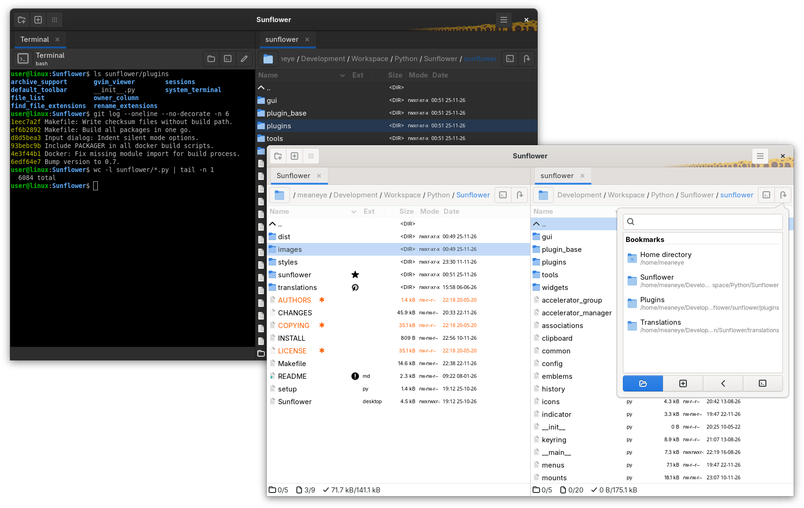

<p align="center">
	
</p>

<h1 align="center">Sunflower</h1>

Sunflower is a small and highly customizable twin-panel file manager for Linux with support for plugins. It is intended to be an easy-to-use and powerful file manager that seamlessly integrates into the GNOME desktop environment (but not limited to). Fully compatible and native to Wayland compositors.



### Features

* Twin-panel, tabbed interface with sessions
* Built-in terminal emulator, available as a tab in either panel
* Keyboard-oriented, with every shortcut configurable
* Bookmarks, mounts and emblems for marking files and directories
* Remote locations through GIO: Samba, FTP, SFTP, WebDAV and MTP
* Browsing archives as if they were directories
* File operations running in background threads, with queueing
* Light and dark theme
* Extensible through plugins written in Python
* Experimental GTK 4 mode (`SUNFLOWER_GTK=4`)

### Packages

Official packages for the latest release can be downloaded from the [download page](https://sunflower-fm.org/download) or from the releases page on [GitLab](https://gitlab.com/MeanEYE/Sunflower/-/releases) and [GitHub](https://github.com/MeanEYE/Sunflower/releases). The following formats are provided:

* DEB for Debian, Ubuntu, Linux Mint and elementary
* RPM for Fedora, RedHat, Mageia, Mandriva, OpenSUSE and PCLinuxOS
* Arch Linux package
* Flatpak
* Python package
* Standalone single-file executable
* Generic archive

Packages maintained by the community:

* Arch Linux AUR: [sunflower-bin](https://aur.archlinux.org/packages/sunflower-bin) (latest release) or [sunflower-git](https://aur.archlinux.org/packages/sunflower-git) (development version)

### Running from source

Sunflower has no compile step. Once the dependencies listed in [INSTALL](INSTALL) are installed, it can be run directly from the source tree:

```sh
python3 -m sunflower
```

### Plugins

Plugins can be installed locally to: `~/.config/sunflower/user_plugins/<plugin_name>`

### How to contribute
You can be a part of this project in many ways. We suggest visiting our IRC channel `#sunflower` on `libera.chat` and we'll try to help you get started.

And as usual testers are more than welcome. If you wish to help translate the program to your language please join the translation team(s) on [Transifex](https://explore.transifex.com/way2cu/sunflower/).

### Staying in touch
Preferred way of getting in touch with us is through our IRC channel, `#sunflower` on `libera.chat`, or through the [contact form](https://sunflower-fm.org/contact) on our website.

I like talking to people a lot so please feel free to contact me any time.

### License
Sunflower is free software, released under the [GNU General Public License version 3](COPYING) or later.
